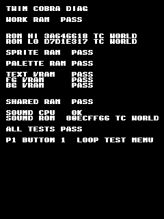
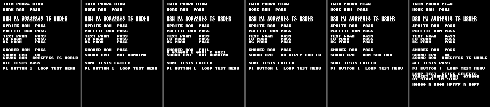
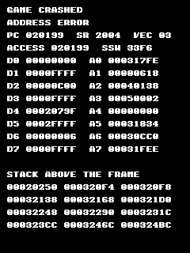
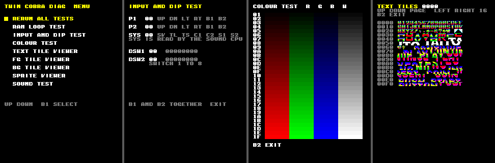
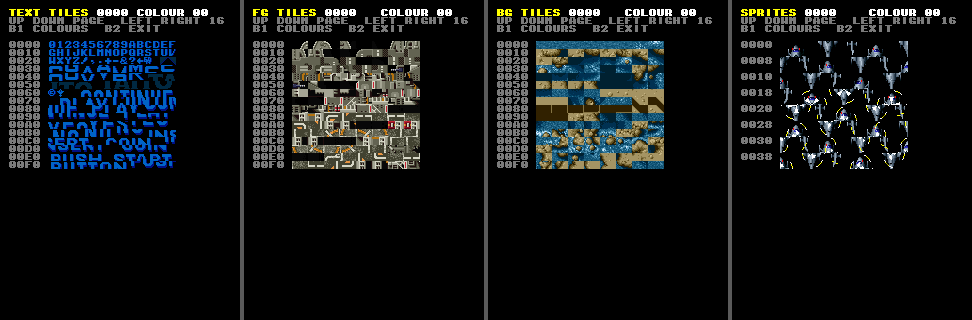
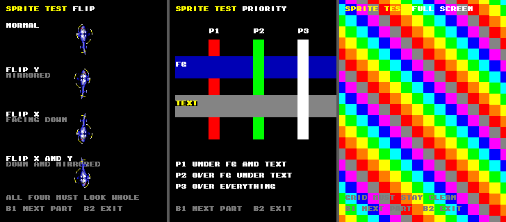
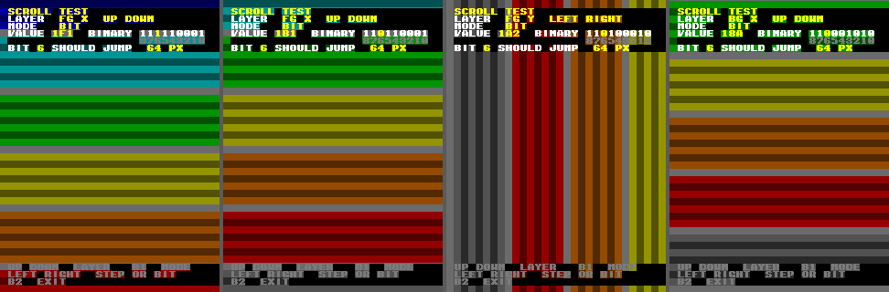
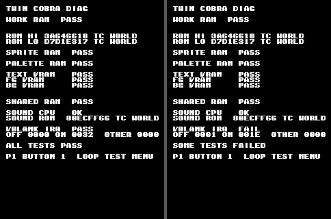
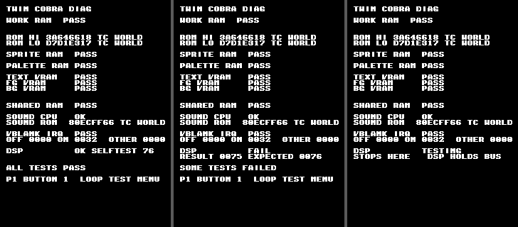

# Twin Cobra / Kyuukyoku Tiger diagnostic ROM

A generic power-on diagnostic for the Toaplan TP-011 PCB family (Twin Cobra /
Kyukyoku Tiger), bootleg and original. Design and rationale: [../SPEC.md](../SPEC.md).
Hardware reference: [../research/FINDINGS.md](../research/FINDINGS.md).

## Status
- **Stage 0** — RAM-less CPU-alive heartbeat (now implicit: any pin toggle = CPU ran).
- **Stage 2** — video bring-up: HD6845 CRTC init (R0-R9 = `DE A0 B0 8F 22 06 1E 1F 00 07`,
  measured from the game ROM), whole-palette flood, screen on. The screen comes up FIRST
  (unlike the stock ROM) and shows a solid status colour. Verified in MAME (screenshots in
  `doc/`).
- **Stage 2b** — on-screen text using the game's own char-ROM font (digits `0x00-0x09`,
  `A-Z` `0x0A-0x23`, blank `0x2D`): white 8x8 text on black. Prints a header and the work-RAM
  result, with the failing address/expected/got in hex on failure. Verified in MAME
  (`doc/stage2b_text_pass.png`, `doc/stage2b_text_fail.png`). Note: text leans on the char
  ROM, text VRAM and palette RAM being good; the heartbeat pin remains the dead-board fallback.
- **Stage 1** — work / DSP-shared RAM test `$30000-$33FFF`, register-only. Done, verified
  in MAME on both a good board (PASS) and a forced fault (FAIL). Verified on a real
  bootleg board (PASS).
- **Stage 3** — CRC32 of each 27256 program chip at `$020000` (identified against the
  known MAME sets), sprite RAM `$40000` and palette RAM `$50000`. Every test runs and
  reports even if an earlier one failed. Verified in MAME (`doc/stage3_pass.png`,
  `doc/stage3_fault.png`).
- **Loop-test menu** — P1 button 1 after the tests: pick work / sprite / palette RAM and
  loop write/read on it for scoping, with a scope trigger on the heartbeat pin and live
  read-backs. Verified in MAME (`doc/loop_menu.png`), also after a work-RAM failure.

### On-screen text report (white on black, monitor is vertical/ROT270)
```
TWIN COBRA DIAG
WORK RAM  PASS                    (or WORK RAM FAIL + detail line, then it stops)

ROM HI 3A646618 TC WORLD           CRC32 of the even (D8-D15) 27256 + matched set
ROM LO D7D1E317 TC WORLD           CRC32 of the odd  (D0-D7)  27256 + matched set
NO VBLANK SIGNAL                   (only if $78009 bit 7 never toggles)
SPRITE RAM  PASS                   (or FAIL + "A <addr> E <exp> G <got>")
PALETTE RAM PASS                   (or FAIL + detail line)
TEXT VRAM   PASS                   stage 4: video RAM behind the offset/data ports
FG VRAM     PASS
BG VRAM     PASS                   (a FAIL adds "A <offset> E <exp> G <got>")
SHARED RAM  PASS                   stage 5: Z80 shared RAM (or FAIL + detail line)
SOUND CPU   OK                     (or NOT RUNNING / ROM SUM BAD / NO REPLY CMD xx)
SOUND ROM   80ECFF66 TC WORLD      CRC32 of sound ROM $4000-$6FFF, read through the Z80
VBLANK IRQ  PASS                   stage 6: interrupts (or FAIL)
OFF 0000 ON 0032 OTHER 0000          IRQs counted: enable off / on (50 frames) / other levels
DSP         OK SELFTEST 76         stage 7: the game's DSP self-test (or FAIL / NO REPLY / SKIPPED)
ALL TESTS PASS                     (or SOME TESTS FAILED)
```

Source: [src/diag.s](src/diag.s) (the evolving main image). `src/stage0.s` is the
heartbeat-only ROM, `src/spin.s` the reads-only ROM.

Earlier builds showed status as a full-screen colour (blue/green/red, `doc/stage2_*.png`);
the text report replaced that.

- **Stage 4** — text / foreground / background video RAM. Verified in MAME (pass and a
  forced FG fault).
- **Stage 5** — Z80 shared RAM, Z80 start-up handshake, sound ROM sum and CRC through the
  Z80. Verified in MAME (pass, dead Z80, bad shared RAM, no start signal, bad sound ROM).
  An earlier build hung on real boards right after `BG VRAM PASS` (it tested shared RAM
  with the Z80 in reset); fixed, see the stage 5 section.

- **Stage 6** — VBLANK interrupt gating: no interrupt with the enable off, one per frame
  with it on, no other levels. Verified in MAME (pass, and a forced leaking gate). Added
  after a real board crashed the game because the interrupt got through while off.

- **Main menu** — input/DIP test, colour test, text/FG/BG tile viewers, sprite viewer,
  sprite test (flip, priority, full screen), scroll test for all three layers, sound test,
  DSP test, RAM loop test, rerun. Verified in MAME (`doc/menu_pages.png`, `doc/menu_viewers.png`).

- **Stage 7** — DSP (TMS320C10): the game's own self-test. Verified in MAME (pass, a bad
  DSP ROM bit, a dead DSP). Also on the menu as DSP TEST.

## Heartbeat / result codes (mainlatch LS259 Q2, pin 6, of $7800D)
- **Nothing toggling** → the 68000 is not executing: check 28 MHz clock + divisions,
  `/RESET`, program-ROM fetch at `$000000`, `/DTACK`.
- **Slow steady square wave** → all tests so far PASSED.
- **Bursts of 4 fast pulses + long gap** → a test FAILED. On failure these registers are
  frozen (inspect in MAME, or a later on-screen stage will show them):
  `A5` = failing address, `D5` = expected word, `D6` = word read back.

## Stage 1 — what it tests
Work RAM `$30000-$33FFF` (16 KiB; also holds the 68000 stack), register-only so it reports
even with dead RAM:
1. data-bus walking-ones at the base word (stuck/bridged data lines),
2. address/data uniqueness — every word written its own index, then verified (stuck/shorted
   address lines, aliasing, dead cells),
3. march patterns AAAA then 5555 (each cell must hold both polarities).

## Loop-test menu (for scoping a failing RAM)
When the tests finish the screen shows `P1 BUTTON 1  MAIN MENU`; the loop test is the
main menu's RAM LOOP TEST entry. If **work RAM failed**, the main menu can't run (it needs
the stack), so the screen shows `P1 BUTTON 1  LOOP TEST MENU` and button 1 opens this menu
directly:

```
LOOP TEST  STICK SELECTS
TARGET SPRITE RAM  040000          P1 up/down: WORK RAM / SPRITE RAM / PALETTE RAM
B1 START  B2 STOP  IN 00            IN = live P1 inputs (hex)

W0000 R 0000  WFFFF R FFFF         live read-backs while looping
```

B1 starts a tight loop on the first word of the chosen RAM: write `0000`, read, write
`FFFF`, read, repeat. Every data line toggles on every cycle, so you can follow one line
with a scope from the 68000 through any 74LS245 buffers to the RAM pins and see where
it stops toggling or gets stuck. The heartbeat pin (mainlatch LS259 **pin 6**) goes high
at the start of each cycle, which makes a clean **scope trigger**. The two values read
back are shown live, so a stuck or floating bit is visible on screen as well (a good
board shows `0000` and `FFFF`). B2 (or B1) stops the loop and returns to the menu.
`IN xx` shows the P1 input byte live, in the menu and while looping: up `01`, down `02`,
B1 `10`, B2 `20`. If a button does nothing, check here whether the board sees it at all.

The menu and loop use no stack or work RAM, so they still work on a board whose work
RAM failed. Inputs: P1 at `$78004`, active high (bit 0 up, 1 down, 4 B1, 5 B2).

## Stage 3 — what it tests
1. **Program ROM CRC32, per chip.** The two 27256s at `$020000-$02FFFF` hold the game's
   entry point (`$20194`), so a bad chip there gives a black screen immediately. Each byte
   lane (one chip) is CRC32'd in circuit with the same algorithm MAME uses, so the number
   on screen can be compared with any MAME set. Known sets are named on screen:
   `TC WORLD`, `TC USA`, `K TIGER`, `K TIGER ALT`; anything else shows `UNKNOWN` and
   counts as a failure. Testing in circuit also catches socket, decode and data-line
   faults that a programmer read would miss.
2. **Sprite RAM** `$40000-$40FFF`: same walk / uniqueness / AAAA / 5555 test as work RAM,
   but done in short bursts that each start right after VBLANK ends. Afterwards sprite RAM
   is cleared to zero, which turns every sprite off, so test patterns never show on screen.
3. **Palette RAM** `$50000-$50DFF`: same test with the **screen turned off**, comparing
   bits 0-14 only (xBGR_555 bit 15 is unused and may not be stored). The test overwrites
   the palette, which is restored straight afterwards so the text stays readable.

**Why the timing matters (real hardware only).** The video hardware uses sprite RAM and
palette RAM too, and the CPU gets clean access only at certain times. The game's own RAM
test (`$25c0a-$25dd2` in the 27256 pair) shows when: it waits for VBLANK (`$78009` bit 7)
to end before each sprite RAM burst, and it turns the screen off (latch `0x0E`) before
testing palette RAM. Earlier diag builds did neither. On real boards they reported false
SPRITE RAM / PALETTE RAM failures and left black-and-white garbage blocks on screen, while
MAME (which doesn't model the contention) passed. If VBLANK never arrives, the diag prints
`NO VBLANK SIGNAL`, counts it as a failure, and runs the sprite test unsynced.

The loop-test menu follows the same rules: sprite RAM bursts are synced to VBLANK, and the
screen is blanked during each palette RAM burst, so the picture flickers on that target.

Takes about a second to run.

## Stage 4 — video RAM (text / foreground / background)
The game tests these three RAMs before it ever turns the screen on, and **if any of them
fails it never starts the sound CPU and hangs** in the same loop as a dead Z80 (see stage 5).
They are reached through an offset register plus a data port (text `$70004`/`$7E000`, bg
`$72004`/`$7E002`, fg `$74004`/`$7E004`; no auto-increment). Each one gets an
address-uniqueness pass (every word its own offset) and the game's own AAAA / 5555 passes,
with the screen off as the game does. Sizes: text 2048 words, fg 4096, bg 4096 (bank 0).
The text test overwrites the on-screen report, so the text layer is copied to work RAM
first and put back afterwards. The detail line shows the **last** failing layer; its
`A` value is the word offset inside that layer.

## Stage 5 — sound CPU (Z80)
**Why it matters:** right after its RAM tests the game asks the Z80 for blocks of the sound
ROM and waits for an answer with **no timeout** (`$25F4A`: wait for `FF` at `$7A001`).
A dead Z80, bad sound ROM or bad shared RAM gives a permanent black screen with the
screen-enable latch (LS259 pin 12) low, and the sound-reset latch (pin 5) high.

**The 68000 can only reach shared RAM through the Z80's bus.** On the bootleg schematic an
access to `$7Axxx` drives the Z80's `/BUSRQ` (pin 25, from K12 74LS138 output O5) and the
68000 waits until the Z80 answers `/BUSACK` (pin 23, via K4 74LS74 and K5 74LS32 into the
J16 DTACK gate). A Z80 that is held in reset, has no clock, or is dead never answers, and
the 68000 then waits forever; no software timeout can catch that. So before it touches
shared RAM the diag releases the Z80 and prints:

```
SHARED RAM  WAIT Z80 BUS
```

**If the screen stops on that line, the Z80 is not granting its bus.** Check, on the Z80:
clock (pin 6), `/RESET` (26, must be high), `/BUSRQ` (25, goes low and stays low = the
68000 is asking), `/BUSACK` (23, never goes low = the Z80 is not answering), then the
K4 / K5 / J16 path back to the 68000's `/DTACK` (pin 10).

(An earlier build tested shared RAM with the Z80 held in reset: that hangs on real boards
right after `BG VRAM PASS`. MAME doesn't model the bus request, so it passed there.)

1. **Z80 start-up**, using the protocol from the game and its Z80 code (`$2F7B`): out of
   reset its first code writes `FF` to `$8000` (68000 `$7A001`) and `00` to `$8001`, then
   waits for `AA` at `$8001`. No `FF` within ~3.5 s: `SOUND CPU NOT RUNNING` (reported after
   the shared RAM test). Check its clock, `/WAIT` (24), `/HALT` (18) and the sound ROM.
2. **Shared RAM** `$7A000-$7AFFF` (2 KiB, 8-bit: the low byte of each word; Z80 `$8000-$87FF`),
   tested while the Z80 sits waiting for `AA`. The march patterns are `A5`/`5A` rather than
   `AA`/`55`, so the test can't start the Z80 by accident.
3. **Start and ROM check:**
   - write `AA` (start). The Z80 adds up its whole ROM; if the sum is not 0 it writes `00` and
     stops for good: `SOUND CPU ROM SUM BAD` - re-read / replace the sound ROM.
   - send the game's 12 commands `F0`-`FB`: for each the Z80 copies 1 KiB of its ROM
     (`$4000 + n*$400`) into shared RAM and answers `FF`. No answer: `NO REPLY CMD xx`.
4. **Sound ROM CRC32** over those 12 blocks (`$4000-$6FFF`), so the sound ROM is checked
   through the Z80 itself. `80ECFF66` = `b30_05_ii.4f` (Twin Cobra World). Other sets use a
   different sound ROM and show `UNKNOWN`, which is **not** counted as a failure.

The loop-test menu has a fourth target, **SHARED RAM** (`$7A000`). Entering the menu restarts
the Z80 and leaves it waiting for `AA`, so it only reads `$8001` and keeps granting its bus.
Only D0-D7 exist there, so for this target the read-backs show just that byte
(`W00 R 00  WFF R FF` on a good board) with the note `8 BIT RAM  D0 TO D7 ONLY`.



Left to right: good board, dead Z80, bad shared RAM bit, Z80 never gets the start signal,
bad sound ROM, loop menu on SHARED RAM (`doc/stage5_faults.png`):



**MAME note:** MAME does not wire latch Q1 to the Z80 reset (the Z80 always runs), but the
bootleg schematic does (LS259 K17 pin 5 → Z80 `/RESET`). MAME also doesn't model the
`/BUSRQ`-`/BUSACK` handshake. The stage-5 tests in MAME were run with a Lua script that adds
the reset wiring and flags any 68000 access to shared RAM while the Z80 is in reset (a hang
on real hardware).

## Crash catcher (when the diag passes but the game still shows a black screen)
The game points every 68000 exception vector at `$100`-`$108`, which hold `$4848` - an
illegal opcode on a 68000. So **any** fault (bus error, address error, illegal instruction)
becomes an endless exception loop with the screen still off: a black screen, `/AS` pulsing
and **every address line toggling** as the stack runs down through memory.

`make crash` builds a copy of **the game's own** 27512 pair with a small handler
(`src/crash.s`) added in unused ROM space (`$1A400`, FF-filled in the World set), the
exception vectors 2-63 pointed at it (IRQ4 = the game's VBLANK handler and IRQ7 are left
alone), and 4 spare bytes per chip adjusted so the game's own ROM checksum (`$25E54`) still
passes. The game runs exactly as before; if it crashes, the screen comes on with:

```
GAME CRASHED
ADDRESS ERROR                      exception type
PC 020199  SR 2004  VEC 03         where it happened
ACCESS 020199  SSW 33F6            bus / address error only: address it tried, R/W + FC
D0 00000000  A0 000317FE           all registers (A7 = stack pointer)
...
CODE 4848 4848 4848 4848           the 4 words at PC
STACK ABOVE THE FRAME              12 longs the crashed code had on its stack:
00020250 000320F4 ...                saved registers and return addresses (its callers)
```

Lines are double-spaced so they stay readable on a monitor whose picture is squeezed.



(Forced in MAME: a jump to an odd address.) The
handler also clears sprite RAM so the game's sprites don't cover the text, and then blinks
the diag's fail pattern on LS259 pin 6.

**Build:** the images contain game code. They are committed in `build/` only because this
repository is private; **remove them before making it public.** To rebuild from your own ROMs:

```
make crash ROMS=<folder with b30_01.7j and b30_03.7h>
```

That writes `build/twincobr_crash_7j.bin` (even, socket `b30_01.7j`) and
`build/twincobr_crash_7h.bin` (odd, `b30_03.7h`). Burn them on two 27C512s in place of the
game's 27512 pair; keep the game's 27256s and all other ROMs. Only the Twin Cobra World set
is accepted (the tool checks the CRCs, the free space and the vectors first).

**Reading the result:** look up the PC in a disassembly of the game. A PC in the ROM checks
(`$25B40`-`$25E76`) or near a ROM-checksum failure points at ROM/socket trouble; an
`ACCESS` address points at the device the CPU couldn't read or write; a PC that isn't in
ROM at all (or `$000100`-`$000108`) means the CPU jumped somewhere wild - often a bad
program ROM byte or data line.

## Main menu (P1 button 1 after the tests)
When the tests are done and work RAM passed, hold **P1 button 1** to open the main menu
(modelled on the Shinobi test ROM's menu). Up/down move, B1 opens a page, **B2** goes back
(on the input test: **B1 and B2 together**, since every button is being tested there). If
work RAM failed, button 1 opens only the register-only RAM loop menu, because the main menu
needs the stack.

| Entry | What it does |
|---|---|
| RERUN ALL TESTS | Runs every test again from the start |
| RAM LOOP TEST | The scope loop menu (see above); B2 comes back to the main menu |
| INPUT AND DIP TEST | P1, P2, coin/start/service/test/tilt and both DIP banks, live |
| COLOUR TEST | 31 steps each of red, green, blue and white |
| TEXT / FG / BG TILE VIEWER | 256 tiles of that layer per page, straight from its ROMs |
| SPRITE VIEWER | 64 sprites per page |
| SPRITE TEST | Flip bits, the 3 sprite priorities, and a full screen of 512 moving sprites |
| SCROLL TEST | Scrolls the text, FG or BG layer over a test pattern |
| SOUND TEST | Sends a sound code to the Z80 and shows whether it answered |
| DSP TEST | Runs the DSP self-test again (stage 7); B1 repeats it |




**Input test.** Each name lights up yellow while pressed: `UP DN LT RT B1 B2` for P1 and P2;
`SV TL TS C1 C2 S1 S2` = service, tilt, test, coin 1, coin 2, start 1, start 2. That last group
is wired to the **sound CPU**, not the 68000: the Z80 copies it to shared RAM, so it only
works when stage 5 passed. DIP switches are shown as `0`/`1`, switch 1 first.

**Colour test.** Every line is one level (01-1F) of the 5-bit red, green and blue channels and
white. A bad resistor, buffer or DAC bit shows as a missing step or a repeated pair of lines
in that bar. It uses the text layer: characters `$7F0`-`$7F6` in the char ROM are solid
blocks of pens 1-7, and each text colour set gets one level.

**Tile and sprite viewers.** Up/down = one page, left/right = 16 pages (sprites: 8). The
number on each row is the first tile on it. They start in the **game's own colours**: the
palette the game loads, captured from MAME (`src/gamepal.inc`). **B1** steps through the
layer's colour sets (`COLOUR 00`, `01`, ... - text 32, FG and BG 16, sprites 64; tiles don't
store a colour, the game picks one per tile), and after the last one switches to
**plane colours** (`PLANES`): each bitplane gets its own colour (text: red, green and blue;
FG, BG and sprites: red, green, blue and "brighter" for the 4th plane). Game colours make
the graphics recognisable; plane colours make a dead or wrong ROM, a missing ROM data line
or a stuck bitplane show as a whole colour missing or stuck across the page. A bad address
line shows as repeated or swapped tiles in either mode. Compare a page with the same page of
this diag in MAME (`doc/menu_viewers.png` shows page 0 of each).

To recapture the palette from your own ROM set (needs MAME):
`PALOUT=<folder> mame twincobr -autoboot_script tools/capture_pal.lua`, then
`python3 tools/make_gamepal.py <folder> src/gamepal.inc`. Text = 2048 chars
(8 pages), FG = 8192 tiles (32 pages, the upper 16 through the FG ROM bank bit), BG = 4096
(16 pages), sprites = 2048 (32 pages). Sprites are placed from MAME's sprite offsets; on a
real board they may sit a few pixels off.

**Sprite test.** B1 steps through three parts, B2 exits:

- **FLIP** - the player's helicopter (5 sprites: `$023 $024` top row, `$025 $026` bottom
  row, `$027` tail; the game's colour set `$2F`) four times: **normal**, **flip Y**
  (mirrored left/right: the halves swap places), **flip X** (facing down: the rows swap) and
  **both**. **All four must look like a whole helicopter**: a part that comes out wrong
  points at that flip bit's path (attribute bit 8 = X, mirrors up/down on the rotated
  monitor; bit 9 = Y, left/right). X-flipped sprites are placed 15 pixels differently by the
  hardware (as MAME models it); the test corrects for that.
- **PRIORITY** - three columns of solid sprites across a blue band of FG tiles and a grey
  band of text: **P1** (red) must go under both bands, **P2** (green) over FG but under
  text, **P3** (white) over everything. A column on the wrong side of a band points at the
  priority logic (the priority PROMs and the layer mixing).
- **FULL SCREEN** - all 512 sprites as a coloured grid over the whole screen, moving slowly
  (the list is rewritten every 8 frames). It loads the sprite hardware as much as it can
  be; the grid must stay clean. Streaks, missing rows or garbage lines point at the sprite
  line buffers (MBM2148s on board B of the bootleg) or the sprite RAM read path.



**Scroll test.** Modelled on the Shinobi test ROM's scroll test. It checks one scroll
register at a time, so a bad bit can be pinned down.

- **Up/down** chooses the register: `TEXT X`, `TEXT Y`, `FG X`, `FG Y`, `BG X`, `BG Y`. On the
  rotated monitor the **X** registers move the picture **up/down** and the **Y** registers
  **left/right**. X has 9 bits (0-511 pixels); Y has 9 for FG and BG (64 tiles high) and 8
  for text (32 tiles high).
- **B1** cycles the mode:
  - **AUTO** - 1 pixel every 2 frames. The ruler must glide smoothly: no pauses, steps or
    jumps back.
  - **STEP** - each left/right press moves it exactly 1 pixel (hold to repeat).
  - **BIT** - left/right pick a bit (yellow in the binary value); it is switched on and off
    every half second and the line under the value says how far the layer must jump: 1 pixel
    for bit 0 up to 256 for bit 8.
- **B2** exits.

The panel shows the register value in hex and in binary with the bit numbers underneath.
The layer under test shows a **ruler**. On FG and BG it changes only along the tested
direction: blocks of 8 tiles, each block one of 8 colours (so the pattern repeats only after
512 pixels), tiles inside a block alternating light and dark, and a grey line at the start
of every block - X gives horizontal bands that move up/down, Y vertical bands that move
left/right, and even a 256-pixel jump moves the blocks visibly. On the text layer
every cell shows its column (X) or row (Y) number in hex, low digit and high digit in
alternate cells, with every 8th one yellow. When the text layer is tested, FG shows a fixed
colour ruler behind it as a reference. The panel has to live in the text layer too (it is
the only layer with a font), so the diag moves it the other way each time the scroll passes
a whole tile: it stays in place, apart from the fine scroll within a tile (bits 0-2, up to
7 pixels), which software can't cancel. In BIT mode for bits 3-8 it doesn't move at all.

In BIT mode, step through all bits of each register. A bit where the layer doesn't move,
or moves the wrong distance, is the faulty one. Typical symptoms in the game: a dead low bit
(0-2, the fine scroll within a tile) makes a layer move in steps; a dead higher bit makes it
jump back or forward by a large amount every few steps. On the bootleg the layers' scroll
counters are the 74LS669s on the daughterboard ("Board C", one section per layer): compare
the faulty layer's signal with the same signal of a working layer, as in the Shinobi
repair.



**Sound test.** Up/down change the code by 1, left/right by $10. B1 sends it the way the game
does (code to the Z80's `$8000`, then wait for `FF`): `OK` means the Z80 took it, `NO REPLY`
means it didn't (see stage 5). Codes `01`-`25` are the game's sounds and music, with bits
6-7 selecting the channel group; leaving the page sends `FE`, which stops all sound.

## Stage 6 — interrupts
The game keeps the VBLANK interrupt (68000 level 4) **off** during its start-up tests
(mainlatch `04`) and switches it on only later (`05`). If it gets through anyway, the
game's VBLANK handler runs before anything is set up and the game crashes (with the crash
catcher: `ILLEGAL INSTRUCTION`, `PC 000100`, `SR 2400`, the stack showing the interrupted
start-up test). The diag otherwise runs with all interrupts masked, so it needs a
dedicated test:

1. enable off, CPU accepting all levels, **300 frames** (~5.5 s, long enough to catch a gate
   that only leaks now and then): expect `OFF 0000`;
2. enable on, 50 frames: expect `ON 0032` (50, one per frame; 48-52 passes);
3. any other level or a spurious interrupt at any time: `OTHER` must be `0000`.

An unexpected interrupt is counted once and the handler then masks further ones, so a
stuck interrupt line cannot lock the test up.

**If the screen stops on `VBLANK IRQ  TESTING` / `STOPS HERE IRQ ACK HANG`:** the CPU took an
interrupt and the acknowledge never finished - nothing answered with `/VPA`, so it waits
forever (no software can catch that). On the bootleg schematic the acknowledge path is the
74LS138 at FU12 (inputs FC0/FC1/FC2 = 68000 pins 28/27/26, enabled by `/LDS`; output 7 =
pin 7) → 74LS08 J17 (pin 1 → pin 3) → 68000 `/VPA` (**pin 21**). While it hangs, expect
68000 `/AS` (pin 6) low, FC2-FC0 all high, and pin 21 high instead of low. The netlist shows
FU12's active-high enable (pin 6) unconnected; check what it really goes to on the board.
Since an acknowledge only happens when an interrupt was raised, a hang in the first
(enable-off) phase also means the interrupt leaked through - see the gate below.

**Any other exception** (bus error, address error, illegal instruction, ...) anywhere in the
diag now shows `EXCEPTION nn PC xxxxxx` on the detail line instead of a dead screen. Without a VBLANK input it times the phases
with a delay and only checks that `ON` is not zero.

**On the bootleg schematic** the gate is: LS259 K17 pin 6 (Q2) AND `/RESET_A` (74LS08 D2,
pins 13/12 → 11) → reset (pin 13) of the 74LS74 at C1, which is clocked by VSYNC (pin 11);
its Q (pin 9) → open-collector 74LS03 J14 (pin 12 → 11) → 68000 `/IPL2` (pin 23), pulled up
by resistor network RN_J5 (pin 8). With the enable off, 68000 pin 23 must stay a steady high.
A missing pull-up leaves `/IPL2` floating, which gives interrupts at random moments.



Left: good board. Right: an interrupt let through while the enable is off.

## Stage 7 — DSP (TMS320C10)
The diag otherwise keeps the DSP disabled and in reset. Stage 7 runs the game's own DSP
self-test (twincobr `$23C98`), the way the game does at start-up:

1. start the DSP: latch `0D`, then its reset `00` → `01`;
2. write command `1` to `$30000` (work RAM, shared with the DSP);
3. latch `0C` → `0D`: this interrupts the DSP, which takes the 68000's bus, runs the test
   (a check of its program ROM), writes the result to `$3000E` and `0` to `$30000`, and
   hands the bus back;
4. wait for `$30000` = 0 (timeout ~1.5 s) and read `$3000E`. The game wants **`$76`**.

| Screen | Meaning |
|---|---|
| `DSP OK SELFTEST 76` | the DSP runs, can reach work RAM, and its program ROM sums right |
| `DSP FAIL` + `RESULT xxxx EXPECTED 0076` | it ran, but the result is wrong: suspect its program ROM (on the bootleg two 2732 EPROMs, A4 and A6 on the schematic; MAME notes A0/A1 are swapped between the DSP and these ROMs) or its data path |
| `DSP NO REPLY` | it gave the bus back but never cleared the command: not running its code (clock: CD6 pin 8, 14 MHz; reset: CD6 pin 4 = LS259 K17 pin 4; `/INT`: CD6 pin 5) |
| stops on `STOPS HERE = DSP HOLDS BUS` | it took the bus and never gave it back: the 68000 waits for good (68000 `/BGACK` pin 12 stuck low). Check the DSP, its clock, its PROMs and the bus-request logic (74LS74 E2/E3, 74LS32 D1) |

A board whose DSP holds the bus would never get past stage 7, so before the test the diag
waits about 4 seconds with a flashing `HOLD B2 TO SKIP DSP TEST`: pressing **P1 button 2**
then skips it (`DSP SKIPPED`), and the menu still works. The game itself hangs the
same way on such a board: it switches the DSP on at start-up.



Left to right: good board, one bad bit in the DSP ROM, dead DSP (forced in MAME).

## Fault-injection test (how the FAIL path was verified)
Build a variant whose RAM test points at ROM so writes can't stick:
```
m68k-elf-as -m68000 --defsym WORK_BASE=0x0 src/diag.s -o build/fault.o
m68k-elf-ld -T diag.ld build/fault.o -o build/fault.elf
m68k-elf-objcopy -O binary build/fault.elf build/fault.bin
```
It must land in the FAIL burst pattern (it does).

For stage 3, point the tests at ROM the same way:
```
m68k-elf-as -m68000 --defsym PROG2=0x0 --defsym SPR_BASE=0x10000 --defsym PALT_BASE=0x0 \
    src/diag.s -o build/fault.o
```
Expected: both ROM lines `UNKNOWN`, `SPRITE RAM FAIL A 010000 E 0001 G FFFF`,
`PALETTE RAM FAIL A 000000 E 0001 G 0003`, `SOME TESTS FAILED` (it does; the printed
CRCs match Python's `zlib.crc32` for those bytes).

## Important: the diagnostic keeps the DSP OFF
The game enables the TMS320C10 DSP at boot (control latch `$7800D` bit Q6 = 1), which
hands the DSP the 68000 bus. On a board with a dead/absent/non-responding DSP — common on
bootlegs — enabling it **stalls the 68000**, giving a black screen with only a brief burst
of activity at power-up. This diagnostic keeps the DSP **disabled** (Q6 = 0)
and held in reset through stages 1-6, so the 68000 never hands off the bus, and only
switches it on for the stage 7 DSP test (which can be skipped with P1 button 2 during its
4-second countdown).

## Dead-board bring-up order
1. **Heartbeat ROM** (`build/twincobr_hb_7j.bin` / `_7h.bin`, `make hb`): toggles the
   `$7800D` LS259 Q2 output (pin 6) forever, touching nothing but ROM + that latch.
   - Pin toggles ~1-2 Hz  -> the 68000 runs, fetches ROM, and drives the latch. Good.
   - No toggle at all      -> CPU not running: 28 MHz clock + divisions, `/RESET`,
     program-ROM fetch at `$000000`, or `/DTACK` for the ROM/latch.
2. **Full diagnostic** (`build/twincobr_diag_7j.bin` / `_7h.bin`): with the CPU proven
   alive, this brings up the screen and tests work RAM. Colour/text result, or the
   heartbeat-pin fallback, tells you what failed next.

## Build
Needs GNU binutils for `m68k-elf` (`brew install m68k-elf-binutils`), plus `python3`.

```
make            # -> build/twincobr_diag_7j.bin + build/twincobr_diag_7h.bin
make dump       # disassemble for inspection
make clean
```

## Burn
The two output files are 27512 (64 KiB) images that replace the main-CPU program
ROM pair:

| File | Socket | Bytes |
|------|--------|-------|
| `build/twincobr_diag_7j.bin` | `b30_01.7j` | even (D8-D15) |
| `build/twincobr_diag_7h.bin` | `b30_03.7h` | odd  (D0-D7)  |

Leave the other board ROMs in place. The diagnostic lives entirely in the first
program-ROM pair; the second pair (`.8j`/`.8h`) is not used.

**Bootleg boards: check which sockets you use.** Bootlegs label and lay out the ROMs
differently from the original. The diagnostic must go in the two **27512 (64 KB)
program sockets** — the pair that holds the reset vector at `$000000` (on the original,
`b30_01.7j` / `b30_03.7h`). Many bootlegs also carry two **27256** program ROMs (the
original's `.8j`/`.8h` code at `$020000`); putting the diag there gives a board that
does one brief burst of bus activity and then hangs. Confirmed on a bootleg with
TMM24512 mask ROMs in the 512 positions: a 27C512 drops straight in.

## Stage 0 — how to read it
On power-up the ROM sets a safe state (DSP and sound Z80 held in reset, IRQ off,
screen off) and then toggles **one LS259 latch output — Q2, the VBLANK-interrupt
enable** — as a steady square wave, using only CPU registers (no RAM, no stack, no DSP,
no video). Interrupts are masked in the CPU, so this has no visible effect. (Earlier
builds used Q3, the flip-screen bit, which made a working screen flip every second.)

- Put a scope / logic probe on the mainlatch LS259 (the `$7800D` latch) **Q2 output,
  pin 6**, and reset the board. There are two LS259s; only the mainlatch toggles.
- A steady ~square wave there = the 68000 is alive, reached the ROM, and is
  executing. This is the one thing a black screen cannot tell you.
- No toggle at all = the CPU is not running: check the 28 MHz clock and its
  divisions, `/RESET`, that it can fetch the program ROM at `$000000`, and `/DTACK`.

74LS259 pinout for reference: Q0-Q3 = pins 4-7, Q4-Q7 = pins 9-12, D = 13, /LE = 14,
/CLR = 15, GND = 8, VCC = 16.
